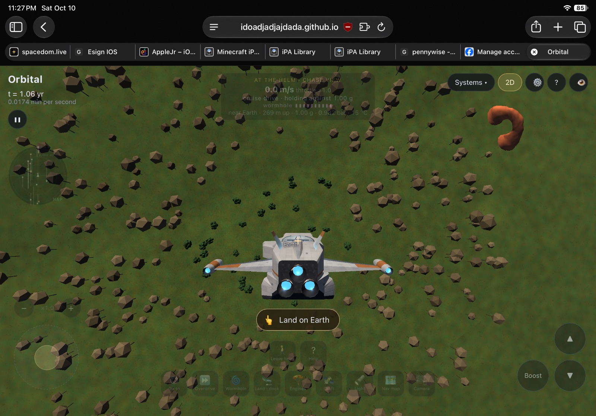
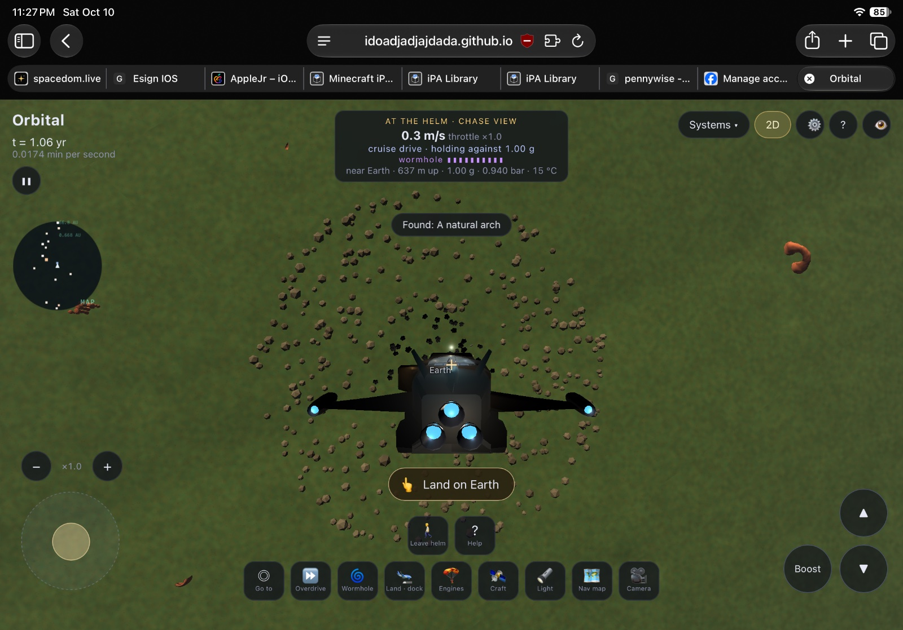
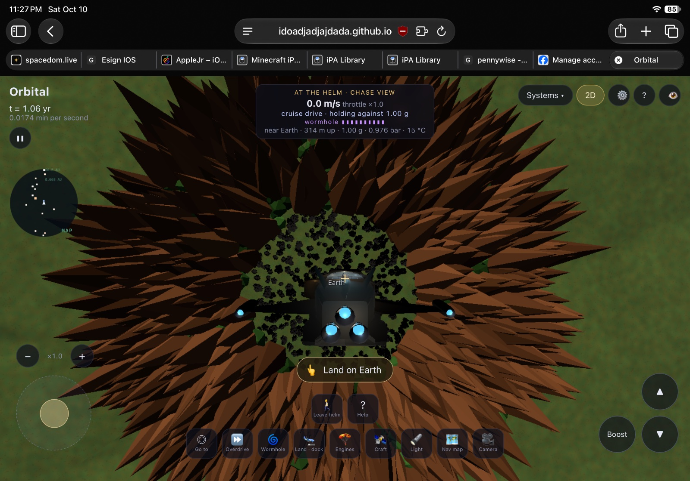
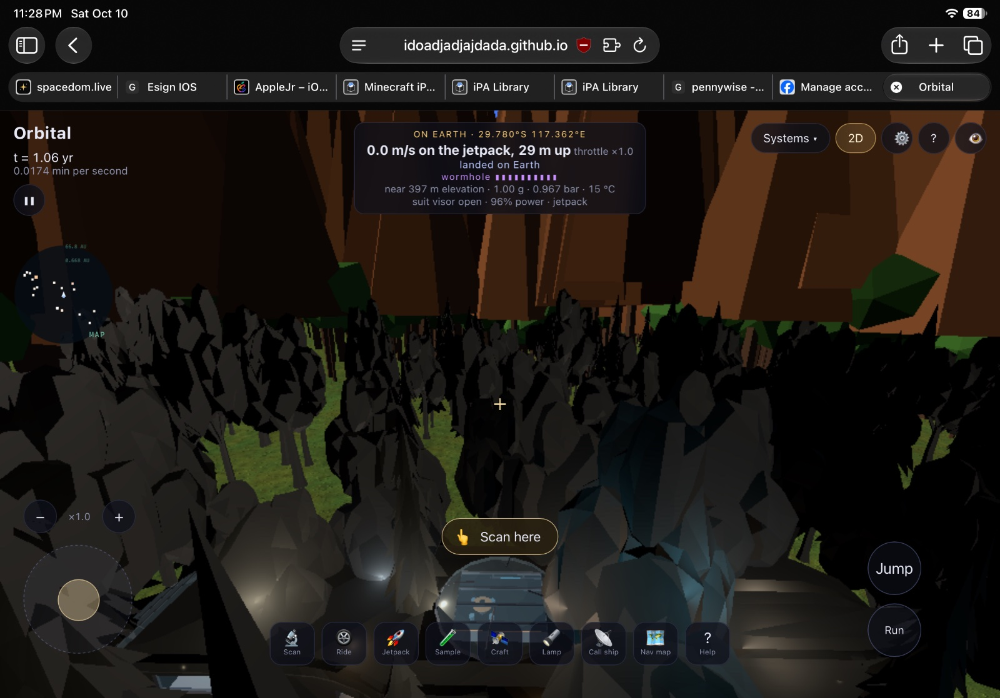
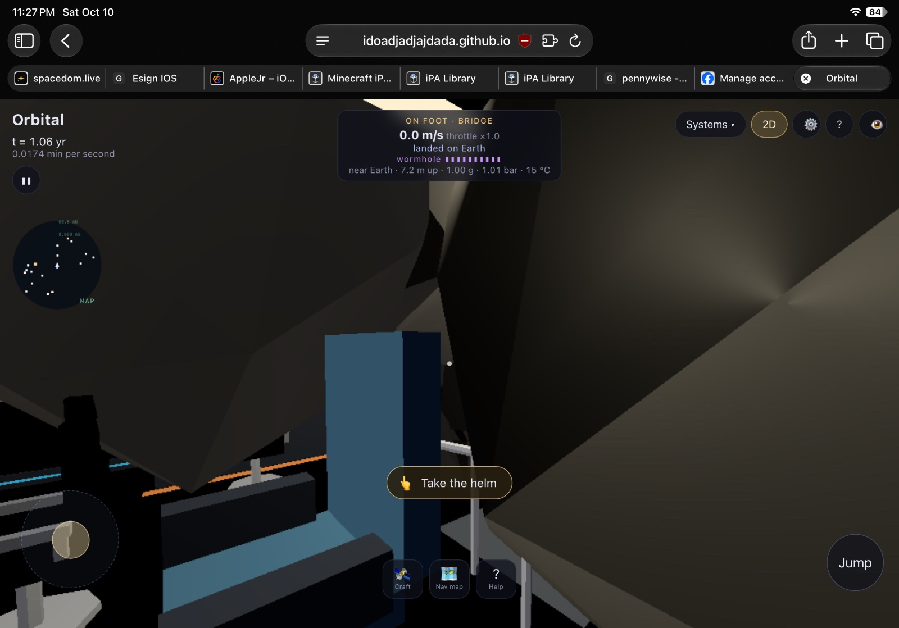
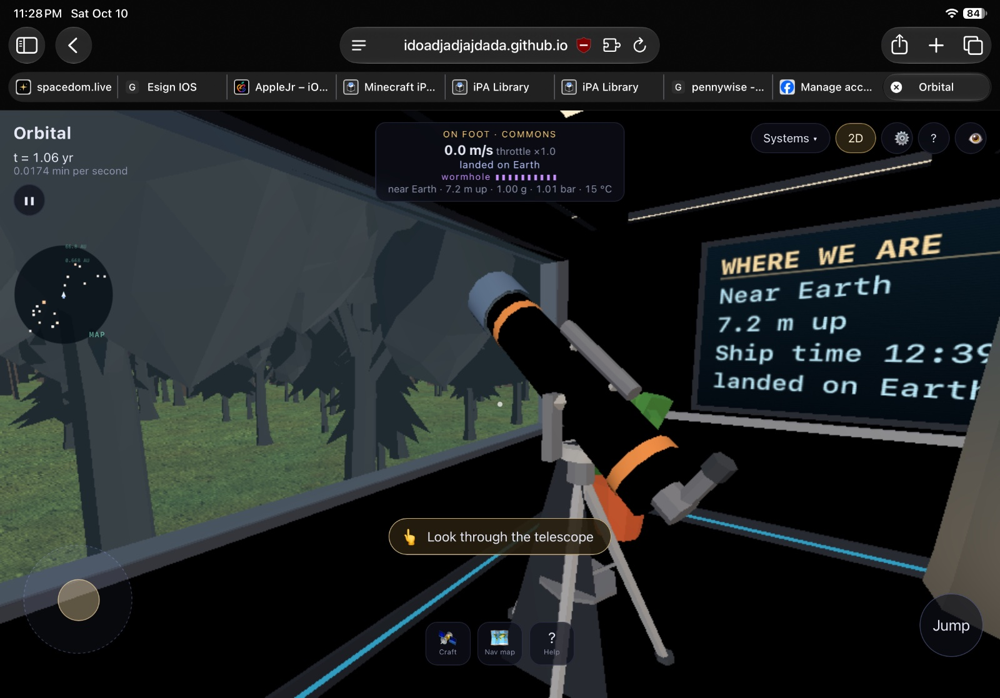
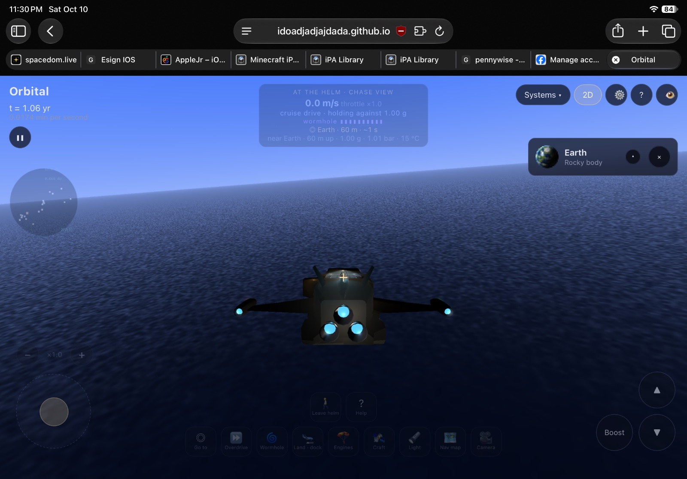
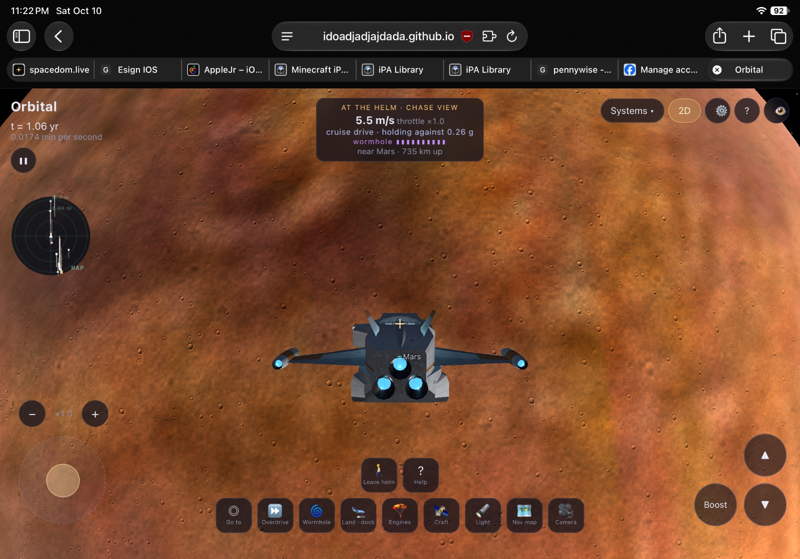
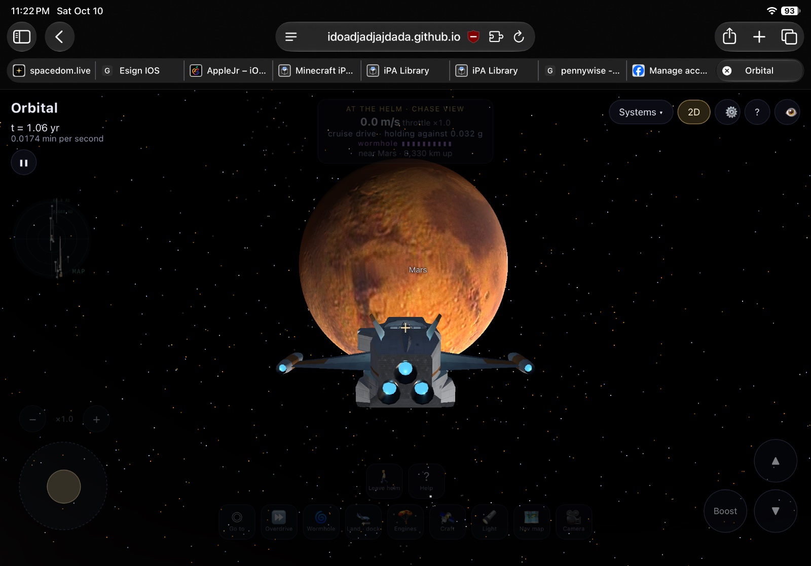
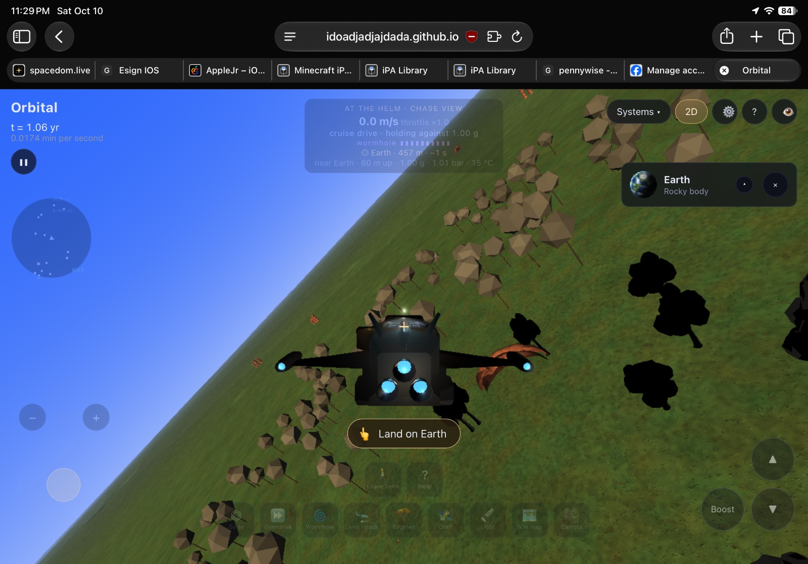

# Feedback, 10 October 2026

Each message as sent, then what was done.

## Bug: Odd ring of terrain features that end up looking horrible, and the trees are bla
Added in the notes app.

> Odd ring of terrain features that end up looking horrible, and the trees are black? Also forms a weird brown spike things??

Done: the brown spikes were far-off trees drawn at full species size in bark colour, and the black trees were the same stand-ins in shade. Far trees now match the near ones, and procedural ruins and landforms that don't belong on Earth are gone (c5990e2).

## Bug: Related to the ring terrain thing. Trees can poke through the ship, not to menti
Added in the notes app.

> Related to the ring terrain thing. Trees can poke through the ship, not to mention the fact the trees have no collision anyway.

Done: trees are cleared round the ship and block you when walking (c5990e2).

## Bug: The ship and its inside become dark when in some places for some reason? Lights 
Added in the notes app.

> The ship and its inside become dark when in some places for some reason? Lights should be lighting the interior but I was on earth anyway.

## Feature: The textures in general are very low quality and inaccurate when you get closer,
Added in the notes app.

> The textures in general are very low quality and inaccurate when you get closer, the terrain should match the texture (not the other way around). The craters look just noise mapped and unintentional, I want them to be accurate. The water doesn’t look realistic either and you can’t even get close to it (or any land for that matter). I want to be able to land on the water because my stuff can float.

## Bug: As shown in the photo, the artifacts/strucutres are completely unrealistic to ea
Added in the notes app · Earth.

> As shown in the photo, the artifacts/strucutres are completely unrealistic to earth, we would never see something like that, and if we did it would be region specific and INTENTIONAL.

Done: the made-up ruins and rock forms are gone from Earth; it has its real monuments instead (Giza, Stonehenge, El Castillo, Ahu Tongariki) (c5990e2).

