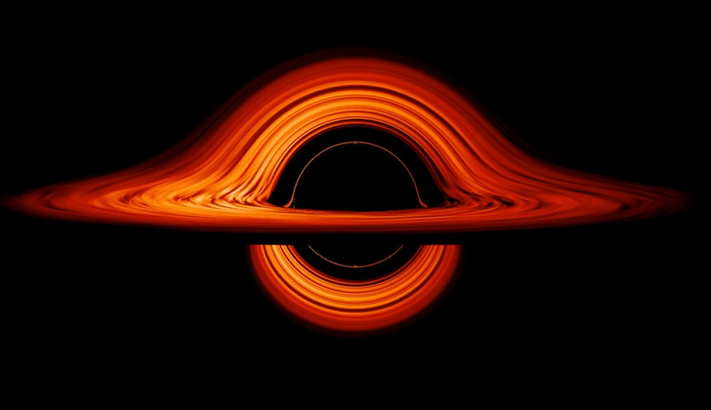
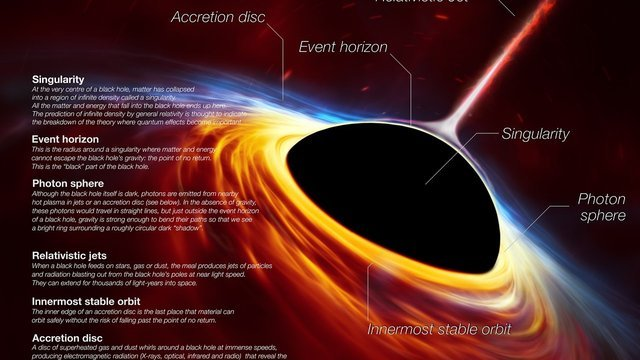
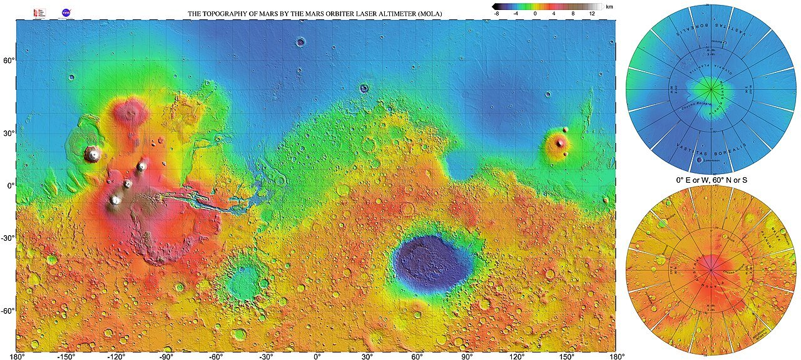
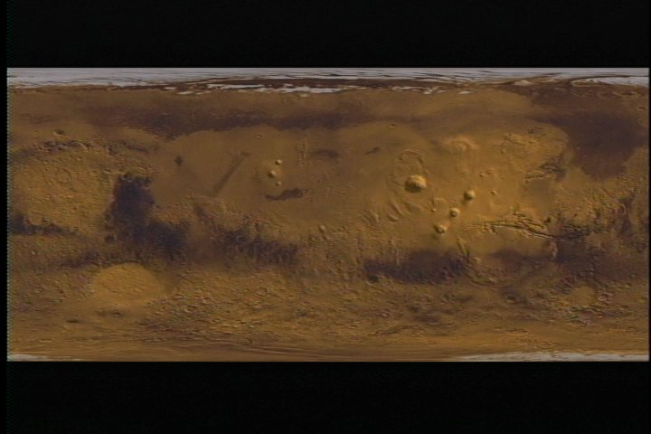
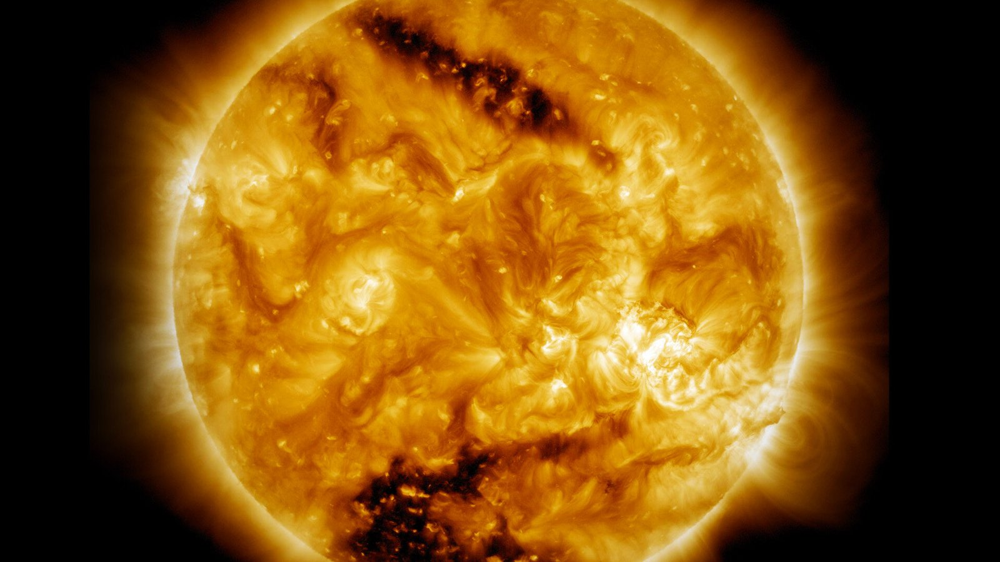

# References

Pictures given as references, and what they were used for.

## Black holes

Used for the traced black holes: the shadow, photon ring, lensed disc and jets (859f630 onwards).

## Mars

Used for Mars' heights and colour, baked by `tools/bake-mars.py` (7d47086).

## The Sun

Used for the Sun's surface, baked by `tools/bake-sun.py` (4af1bd3).

## The measured worlds
Heights baked by `tools/bake-heights.mjs` into `src/pixel/data/`, all public domain, used for the ground and the close-up maps:
- The Moon: LOLA (NASA SVS CGI Moon Kit, https://svs.gsfc.nasa.gov/4720), `ldem_16_uint.tif`, into `moon-height.png` (c5990e2).
- Venus: Magellan's global topography v2 (USGS Astrogeology, https://astrogeology.usgs.gov/search/map/venus_magellan_global_topography_4641m), into `venus-height.png` (77b3894).
- Mercury: MESSENGER's global DEM v2 (USGS Astrogeology, https://astrogeology.usgs.gov/search/map/mercury_messenger_global_dem_665m), 3 rows of every 11 fetched, into `mercury-height.png` (77b3894).
- Mars: MOLA's MEGDR at 16 pixels a degree (PDS Geosciences, `megt90n000eb.img`), into `mars-mola.png` (77b3894).
